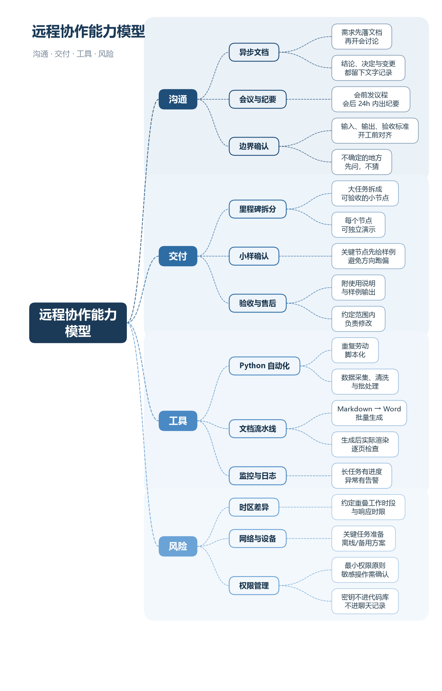

# 思维导图 PNG 生成器 · Mindmap PNG

用 Python + matplotlib 把结构化内容渲染成一张横向思维导图 PNG：自动折行、分支配色、中文字体适配，并在保存前检查「文字溢出框 / 同列重叠」两类版式问题。

> Render a horizontal mind map to PNG from a Python tree. Automatic line wrapping, per-branch colors, CJK font fallback, and a built-in layout self-check before export.



## 功能

- **横向布局**：根节点在左，单向往右展开；每个大分支有独立浅色底纹与配色。
- **自动排版**：按字号与文本宽度估算折行；叶子节点依次排开，父节点自动居中。
- **中文友好**：自动查找微软雅黑 / 苹方 / Noto CJK 字体，适配中文与上下标。
- **版式自查**：导出后检查同列框重叠与文字溢出，终端打印冲突位置，方便批量生成时发现问题。
- **CLI 参数**：输出路径、DPI 可调。
- **纯 Python**：只依赖 matplotlib，不需要浏览器或设计软件。

## 快速开始

```bash
pip install -r requirements.txt
python render_mindmap.py --out docs/demo.png
```

默认读取同目录 `mindmap_data.py` 中的 `TREE`、`BRANCH_STYLES`、`TITLE`、`SUBTITLE`。改完内容后重新运行即可。

### 数据格式

```python
def N(text, children=None):
    return {"text": text, "children": children or []}

TREE = N("根节点", [
    N("分支一", [
        N("子节点"),
    ]),
])
```

`text` 中的 `\n` 表示强制换行；过长的行会自动折行。`year` 字段是可选的（用于给节点加年份标注，配合 `--year` 开启）。

## 参数

| 参数 | 说明 |
|---|---|
| `--out` | 输出 PNG 路径，默认输出到当前目录 |
| `--dpi` | 输出分辨率，默认 200 |
| `--year` | 显示节点上的 `year` 标注（可选） |

## 适用场景

课程复习、项目拆解、知识体系梳理、会议材料配图、报告插图，以及任何「结构化内容 → 一张图」的批量生产场景。

> 这个工具最初是为医学课程复习做的，所以对中文长文本、层级较深的节点做了折行和版式优化；内容本身与医学无关，换成任意主题都能用。

## 实现要点

1. 先按深度计算字号与最大行宽，再估算每个节点的框尺寸。
2. 用「叶子节点顺序排布 + 父节点取子节点中点」的方式分配纵坐标。
3. 绘制分支底纹、贝塞尔连线、圆角节点框与文字。
4. `fig.canvas.draw()` 后取文字的窗口包围盒，与框的坐标比较，输出溢出与重叠报告。

## License

MIT License，见 [LICENSE](LICENSE)。
